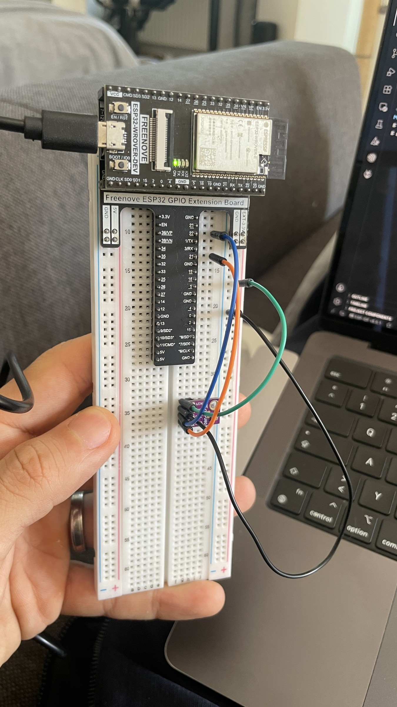
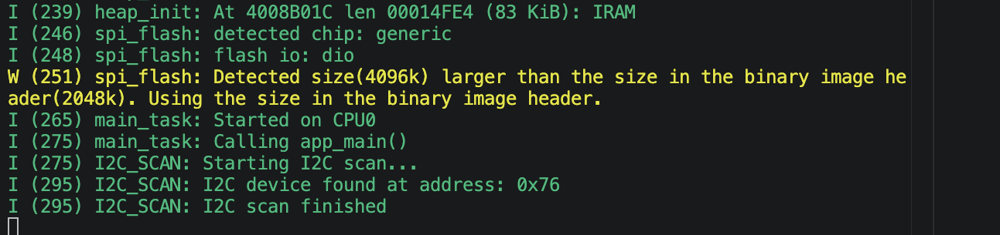
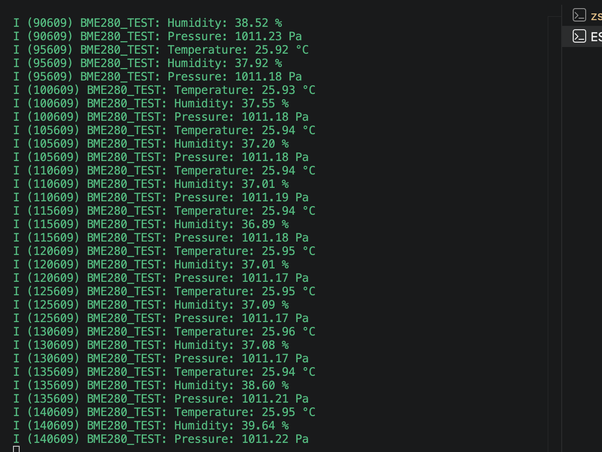
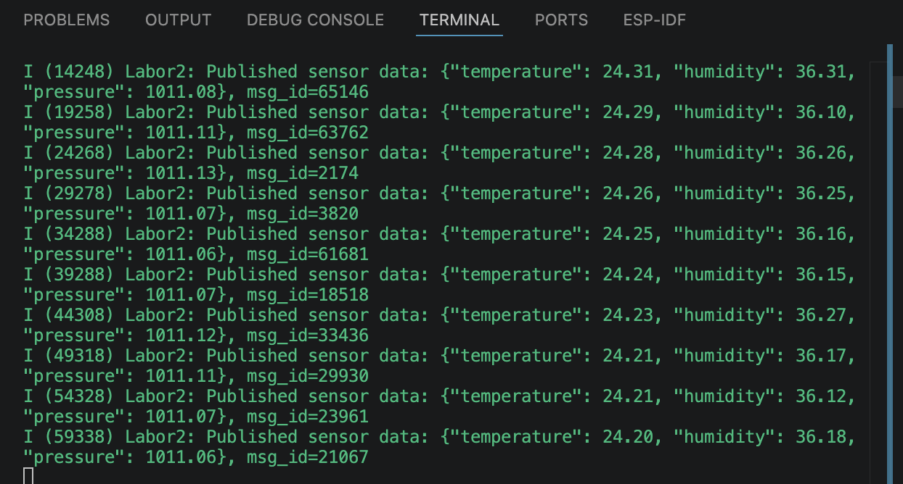

# ESP32 BME280 MQTT — Experimental Results

This directory contains selected evidence from the original
Internet of Things laboratory experiments conducted at
Berliner Hochschule für Technik (BHT) in 2026.

The project uses an ESP32-WROVER-DEV board and a BME280
environmental sensor to acquire measurements and publish
JSON-formatted telemetry through MQTT.

## 1. Hardware Setup

The hardware consists of an ESP32 development board
connected to a BME280 sensor through I²C.

The sensor connections are:

| BME280 | ESP32 |
|---|---|
| VIN | 3.3 V |
| GND | GND |
| SDA | GPIO21 |
| SCL | GPIO22 |

## 2. I²C Sensor Detection

The I²C scanner successfully detected the sensor
at address `0x76`.

This confirmed that the ESP32 could communicate
with the connected device.

## 3. Environmental Sensor Measurements

The sensor test produced periodic readings for:

- Temperature
- Relative humidity
- Atmospheric pressure

The measurements were displayed through the
ESP-IDF serial monitor.

Note: The original sensor-test console labels pressure
as "Pa", although the numerical values around 1011
are consistent with hPa, as used in the project report.
The original output is preserved in the screenshot.

## 4. MQTT Sensor Data Publication

The ESP32 application connects to Wi-Fi and
communicates with an MQTT broker.

Sensor measurements are formatted as JSON messages
containing temperature, humidity and pressure.

The captured serial output shows repeated MQTT
publication requests and their returned message IDs.

The experiment demonstrates the complete workflow:

BME280 → I²C → ESP32 → Wi-Fi → MQTT

## Documentation

[Read the complete academic project report](../docs/report/IoT_Labor2_Public_Redacted.pdf)

## Validation Scope

These screenshots document the original laboratory
experiments performed on ESP32 hardware in 2026.

The public C implementation contains subsequent
security and error-handling improvements.

The revised implementation has not been independently
rebuilt or retested on the original hardware.

The experiment demonstrates functional IoT communication,
not production-ready network security or guaranteed
message delivery.
